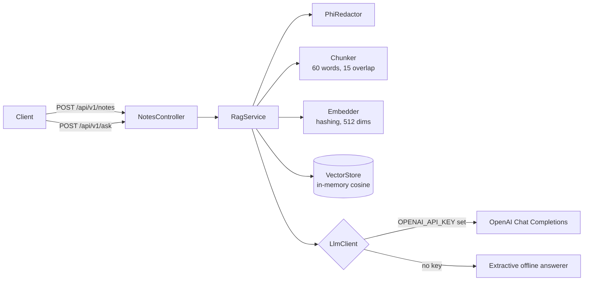

# clinical-notes-rag-service

A Spring Boot 3 / Java 21 service that answers questions over clinical notes with retrieval-augmented generation (RAG). Identifiers are redacted before anything is indexed or sent to a language model.

> **Representative portfolio project.** I wrote it independently using **synthetic data only**. It is not code from, or a copy of, any employer's or client's system. It shows the kind of work I do: Spring Boot APIs, RAG pipelines and HIPAA-aware data handling.

## Business problem

Care teams lose time searching long, unstructured visit notes for one fact, such as "what was the last glucose time-in-range?" or "is there a suspected drug allergy?". This service indexes notes and returns a short answer with the exact note passages it came from, so a clinician can check the source.

## Architecture



- **`core`** has no framework dependencies: chunking, embedding, vector search, redaction and orchestration. It is unit-tested on its own.
- **`api` / `config` / `adapters`** hold the Spring wiring, REST endpoints, error handling and the OpenAI adapter.
- Each piece sits behind an interface (`Embedder`, `VectorStore`, `LlmClient`), so pgvector, OpenSearch or AWS Bedrock can replace the defaults without touching `RagService`.

## Tech stack

Java 21 · Spring Boot 3.3 (Web, Validation, Actuator) · Jackson · java.net.http · JUnit 5 · AssertJ · MockMvc · Docker · GitHub Actions

## Run it

```bash
# Requires JDK 21 and Maven 3.9+
mvn spring-boot:run

# Optional: use OpenAI instead of the offline answerer
cp .env.example .env   # add your key, never commit it
export OPENAI_API_KEY=...   # or set it in your shell
mvn spring-boot:run
```

With Docker:

```bash
docker build -t clinical-notes-rag-service .
docker run -p 8080:8080 clinical-notes-rag-service
```

Eight synthetic notes load at startup (`src/main/resources/data/synthetic-notes.json`).

## API

```bash
curl -s localhost:8080/api/v1/ask -H 'Content-Type: application/json' \
  -d '{"question":"What is the time in range on the glucose monitor?"}'
```

Sample response (offline mode):

```json
{
  "answer": "Continuous glucose monitor shows time in range of 68 percent, up from 61 percent last month.",
  "model": "extractive-offline",
  "sources": [
    { "chunkId": "note-004#0", "noteId": "note-004", "score": 0.241, "text": "Synthetic record. Type 1 diabetes ..." },
    { "chunkId": "note-002#0", "noteId": "note-002", "score": 0.062, "text": "..." },
    { "chunkId": "note-007#0", "noteId": "note-007", "score": 0.056, "text": "..." }
  ]
}
```

The answer draws only on sources scoring within 60% of the best match, so the weak second and third hits don't leak into it.

| Method | Path | Purpose |
| --- | --- | --- |
| POST | `/api/v1/notes` | Index a note `{id, patientRef?, type?, text}` |
| POST | `/api/v1/ask` | Ask a question `{question}` |
| GET | `/api/v1/stats` | Number of indexed chunks |
| GET | `/actuator/health` | Health check |

Errors are returned as RFC 7807 problem details (`400` for validation, `503` when the LLM is unreachable).

## Tests

```bash
mvn verify
```

- `CoreTest`: chunk windows, invalid settings, identifier redaction, cosine math, retrieval ranking, redaction before indexing, empty index.
- `NotesControllerTest`: end-to-end answer from the startup data, validation errors, ingestion.

## Security considerations

- `PhiRedactor` masks SSNs, phone numbers, emails, MRNs and dates **before** indexing and before any LLM call. It is a defense-in-depth example, not a certified HIPAA de-identification method.
- The OpenAI key is read from the environment, never logged, and `.env` is git-ignored.
- The LLM prompt limits answers to retrieved context and asks the model to say when the answer isn't there.
- The container runs as a non-root user. Stack traces are never returned to clients.

## Limitations and next steps

- The hashing embedder is keyword-based. Next: an `Embedder` backed by OpenAI or Bedrock embeddings, and pgvector for persistence.
- No authentication yet. Next: Spring Security resource server with JWT and role-based access per patient.
- Add evaluation: a small labelled question set with retrieval hit-rate and answer-faithfulness checks in CI.

## License

MIT
